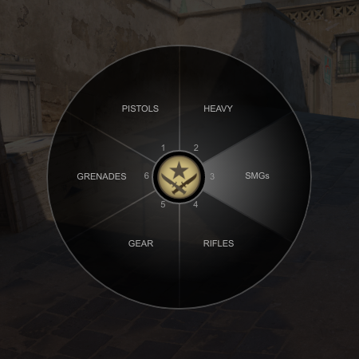
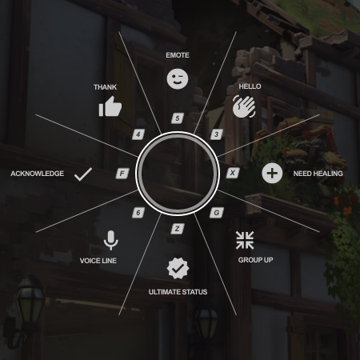
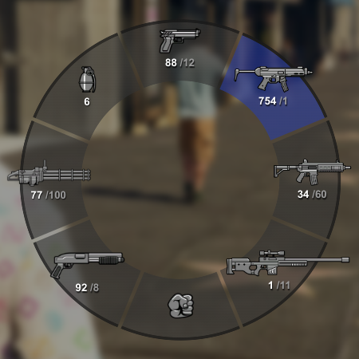
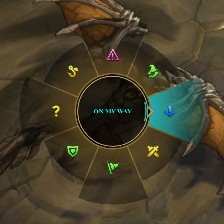
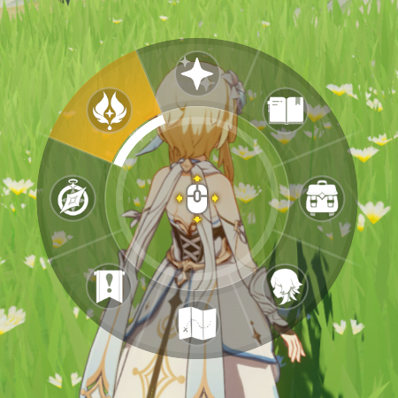

# react-wheel-menu

[][npm]
[](https://github.com/michaelbull/react-wheel-menu/actions?query=workflow%3Aci)
[](LICENSE)

React components & hooks for building a [radial wheel menu][wikipedia-pie-menu].

## Installation

```shell
npm install --save react-wheel-menu
```

## Showcase

<table>
  <tbody>
    <tr>
      <td align="center" width="33%">
        &nbsp;
        <br />
        <a href="https://michaelbull.github.io/react-wheel-menu/?path=/story/examples--counter-strike" target="_blank"></a>
        <br />
        <strong>Counter-Strike</strong>
        <br />
        <a href="https://michaelbull.github.io/react-wheel-menu/?path=/story/examples--counter-strike" target="_blank">Demo</a>
        ·
        <a href="https://github.com/michaelbull/react-wheel-menu/blob/master/src/stories/Examples/CounterStrike/CounterStrike.stories.tsx" target="_blank">Code</a>
        <br />
        &nbsp;
      </td>
      <td align="center" width="33%">
        &nbsp;
        <br />
        <a href="https://michaelbull.github.io/react-wheel-menu/?path=/story/examples--overwatch" target="_blank"></a>
        <br />
        <strong>Overwatch</strong>
        <br />
        <a href="https://michaelbull.github.io/react-wheel-menu/?path=/story/examples--overwatch" target="_blank">Demo</a>
        ·
        <a href="https://github.com/michaelbull/react-wheel-menu/blob/master/src/stories/Examples/Overwatch/Overwatch.stories.tsx" target="_blank">Code</a>
        <br />
        &nbsp;
      </td>
      <td align="center" width="33%">
        &nbsp;
        <br />
        <a href="https://michaelbull.github.io/react-wheel-menu/?path=/story/examples--grand-theft-auto" target="_blank"></a>
        <br />
        <strong>Grand Theft Auto</strong>
        <br />
        <a href="https://michaelbull.github.io/react-wheel-menu/?path=/story/examples--grand-theft-auto" target="_blank">Demo</a>
        ·
        <a href="https://github.com/michaelbull/react-wheel-menu/blob/master/src/stories/Examples/GrandTheftAuto/GrandTheftAuto.stories.tsx" target="_blank">Code</a>
        <br />
        &nbsp;
      </td>
    </tr>
    <tr>
      <td align="center" width="33%">
        &nbsp;
        <br />
        <a href="https://michaelbull.github.io/react-wheel-menu/?path=/story/examples--league-of-legends" target="_blank"></a>
        <br />
        <strong>League of Legends</strong>
        <br />
        <a href="https://michaelbull.github.io/react-wheel-menu/?path=/story/examples--league-of-legends" target="_blank">Demo</a>
        ·
        <a href="https://github.com/michaelbull/react-wheel-menu/blob/master/src/stories/Examples/LeagueOfLegends/LeagueOfLegends.stories.tsx" target="_blank">Code</a>
        <br />
        &nbsp;
      </td>
      <td align="center" width="33%">
        &nbsp;
        <br />
        <a href="https://michaelbull.github.io/react-wheel-menu/?path=/story/examples--genshin-impact" target="_blank"></a>
        <br />
        <strong>Genshin Impact</strong>
        <br />
        <a href="https://michaelbull.github.io/react-wheel-menu/?path=/story/examples--genshin-impact" target="_blank">Demo</a>
        ·
        <a href="https://github.com/michaelbull/react-wheel-menu/blob/master/src/stories/Examples/GenshinImpact/GenshinImpact.stories.tsx" target="_blank">Code</a>
        <br />
        &nbsp;
      </td>
    </tr>
  </tbody>
</table>

## Example

```tsx
import type { CSSProperties } from 'react';
import {
    Label,
    Layout,
    Segment,
    Wheel
} from 'react-wheel-menu';
import 'react-wheel-menu/index.css';

export function Example() {
    const red: CSSProperties = { backgroundColor: 'red', color: 'white' };
    const yellow: CSSProperties = { backgroundColor: 'yellow', color: 'black' };
    const green: CSSProperties = { backgroundColor: 'green', color: 'white' };
    const blue: CSSProperties = { backgroundColor: 'blue', color: 'white' };

    function onClickBlue(event: MouseEvent<HTMLButtonElement>) {
        console.log('Clicked blue', event);
    }

    return (
        <Wheel style={{ width: 300, height: 300 }}>
            <Segment from={315} to={45} style={red}>
                <Layout>
                    <Label>Red</Label>
                </Layout>
            </Segment>

            <Segment from="45deg" to="37.5%" style={yellow}>
                <Layout direction="vertical" justify="start">
                    <Label orient="outwards" offset={-30}>Start</Label>
                </Layout>

                <Layout direction="horizontal" justify="center">
                    <Label orient="upwards" offset={-10}>Up</Label>
                    <Label orient="downwards" offset={-10}>Down</Label>
                </Layout>

                <Layout direction="vertical" justify="end">
                    <Label orient="inwards" offset={10}>End</Label>
                </Layout>
            </Segment>

            <Segment from="37.5%" to="3.92699rad" style={blue} as="button" onClick={onClickBlue}>
                <Layout>
                    <Label>Blue</Label>
                </Layout>
            </Segment>

            <Segment from="3.92699rad" to="0.875turn" style={green} as="a" href="https://example.com" target="_blank">
                <Layout>
                    <Label>Green</Label>
                </Layout>
            </Segment>
        </Wheel>
    );
}
```

## Components

### `<Segment>`

A `<Segment>` must specify the angle it starts `from` and spans `to`, for example:

- A right-angled segment in [degrees][degree]:
    - `<Segment from={0} to={90} />`
- An acute-angled segment in [radians][radian]:
    - `<Segment from="1rad" to="2rad" />`
- An obtuse-angled segment in [gradians][gradian]:
    - `<Segment from="100grad" to="210grad" />`
- A right-angled segment in [turns][turn]:
    - `<Segment from="0.5turn" to="0.75turn" />`
- An obtuse-angled segment in percentages:
    - `<Segment from="50%" to="85%" />`

### `<Spoke>`

A `<Spoke>` is a straight line radiating from the centre of the `<Wheel>`.

Spokes can be used to visually split segments, for example:

```tsx
<Wheel style={{ width: 300, height: 300 }}>
    <Segment from="0deg" to="45deg" style={{ background: 'red' }} />
    <Segment from="45deg" to="90deg" style={{ background: 'blue' }} />
    <Spoke angle="45deg" style={{ background: 'white', height: '100px' }} />
</Wheel>
```

### `<Layout>`

A `<Layout>` controls the distribution and orientation of `<Label>`s inside a
`<Segment>` or `<Spoke>`.

In the `<Layout>` below, the `<Label>` is positioned at the edge of the segment
with the text facing inwards to the center of the wheel.

```tsx
<Wheel style={{ width: 300, height: 300 }}>
    <Segment from={0} to={90}>
        <Layout direction="vertical" justify="end">
            <Label orient="inwards">Inwards Label</Label>
        </Layout>
    </Segment>

    <Spoke angle="45deg" style={{ width: '10px' }}>
        <Layout direction="vertical">
            <Label orient="inwards">Outwards Label</Label>
        </Layout>
    </Spoke>
</Wheel>
```

### `<Ring>`

A `<Ring>` is a band of the wheel between two radii. The `inner` and `outer`
radii are shares of the radius of the wheel: `0` is the centre and `1` is the
edge. Thus a wheel scales by its `width` alone. The segments in a ring show only
inside its band, and their labels move to the middle of the band.

```tsx
<Wheel style={{ width: 400, height: 400 }}>
    <Ring inner={0.6} outer={1}>
        <Segment from={-22.5} to={22.5}>
            <Layout>
                <Label>Far N</Label>
            </Layout>
        </Segment>
    </Ring>

    <Ring inner={0.25} outer={0.6}>
        <Segment from={-22.5} to={22.5}>
            <Layout>
                <Label>N</Label>
            </Layout>
        </Segment>
    </Ring>
</Wheel>
```

The hole of a ring is cut with a CSS mask, and a mask does not change where the
pointer hits. In a `<Wheel>`, the segments of a ring thus also take the hover in
its hole. Put the inner rings after the outer rings, so that each inner ring is
on top. Or use a `<DirectionalWheel>`.

See the [Rings demo][demo-rings].

## `<DirectionalWheel>`

All angles in this library are in degrees clockwise from north. This includes
`from` and `to` of a `<Segment>`, and the direction of the pointer.

A `<Wheel>` shows the segment under the pointer with CSS `:hover` only. A
`<DirectionalWheel>` tracks the pointer and finds the segment that the pointer
points at. The distance has no limit, so the pointer can go past the
edge of the wheel. This is the pie menu of Blender or the comms wheel of
Overwatch: the wheel opens at the cursor, the user flicks in a direction, and
lets go.

- Give each segment a `value`. Only a segment with a `value` can become active.
- The active segment has the `data-active` attribute. Style it with
  `.wheel-segment[data-active]`.
- `deadZone` is a share of the radius around the centre. Nothing is active in
  the dead zone, so the user can let go there to cancel.
- With rings, the distance picks the ring and the direction picks the segment.
  Past the edge of the outermost ring, the outermost ring is used, so a long
  flick still picks a segment.
- `initialPointer` gives the position of the pointer before it first moves, for
  example the position of the key press that opened the wheel.

The wheel never calls back when the selection changes. Read the selection with
`useWheelSelection()` in a component inside the wheel, at the time that your app
decides the gesture ends (for example on `pointerup` or a key release):

```tsx
function Release() {
    const { active } = useWheelSelection();

    useEffect(() => {
        function onPointerUp() {
            console.log('Chose', active);
        }

        window.addEventListener('pointerup', onPointerUp);
        return () => window.removeEventListener('pointerup', onPointerUp);
    }, [active]);

    return null;
}

<DirectionalWheel deadZone={0.3} style={{ width: 260, height: 260 }}>
    <Segment value="undo" from={-45} to={45} />
    <Segment value="copy" from={45} to={135} />
    <Segment value="paste" from={135} to={225} />
    <Segment value="cut" from={225} to={315} />
    <Release />
</DirectionalWheel>
```

`useWheelSelection()` gives `active` (the `value` of the active segment, or
`null`) and `pointer` (the direction and distance of the pointer from the
centre, or `null`).

An app that finds the active segment itself (for example with the helpers
below) uses a `<Wheel>` and gives it the `active` prop: `<Wheel active="undo">`.
The active segment then has `data-active`, as in a `<DirectionalWheel>`.

See the [Flick demo][demo-flick].

### Helpers

These pure functions and hooks give the same values as the wheel, for an app
that tracks the pointer itself:

- `usePointerPosition(initial?)`: the position of the pointer from pointer
  events, so a mouse, a pen and a touch all work. It is `null` until the
  position is known.
- `useElementToPointer(options?)`: the direction and distance of the pointer
  from the centre of an element, and the radius of the element.
- `pointerDegrees(midpoint, point)`: the direction from `midpoint` to `point`.
- `pointerDistance(midpoint, point)`: the distance in pixels.
- `degreesWithin(degrees, from, to)`: whether a direction is in a span, also a
  span across north. `from` is inclusive and `to` is exclusive.
- `segmentAt(segments, degrees)`: the segment that holds a direction, or `null`.
- `activeSegment(segments, pointer, deadZone)`: the value of the active segment,
  with rings and the dead zone, or `null`.

## Contributing

Bug reports and pull requests are welcome on [GitHub][github].

## License

This project is available under the terms of the ISC license. See the
[`LICENSE`](LICENSE) file for the copyright information and licensing terms.

[npm]: https://www.npmjs.com/package/react-wheel-menu
[github]: https://github.com/michaelbull/react-wheel-menu
[wikipedia-pie-menu]: https://en.wikipedia.org/wiki/Pie_menu
[degree]: https://en.wikipedia.org/wiki/Degree_(angle)
[radian]: https://en.wikipedia.org/wiki/Radian
[gradian]: https://en.wikipedia.org/wiki/Gradian
[turn]: https://en.wikipedia.org/wiki/Turn_(angle)
[demo-rings]: https://michaelbull.github.io/react-wheel-menu/?path=/story/examples--rings
[demo-flick]: https://michaelbull.github.io/react-wheel-menu/?path=/story/examples--flick
